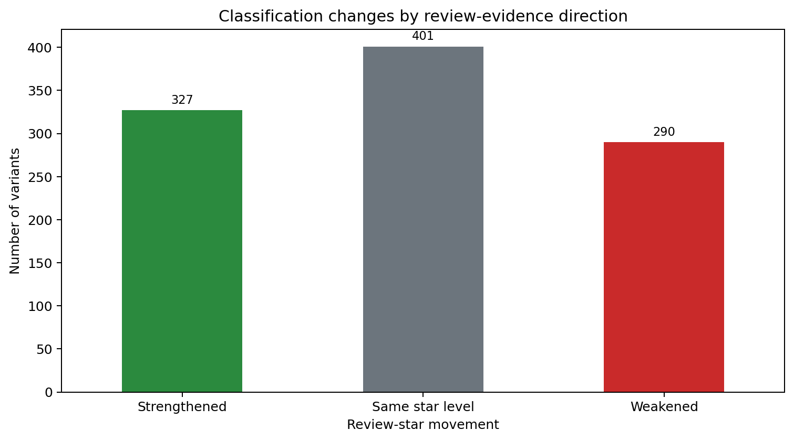
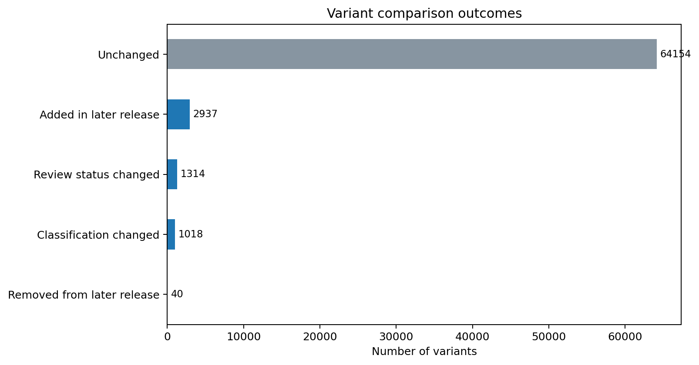
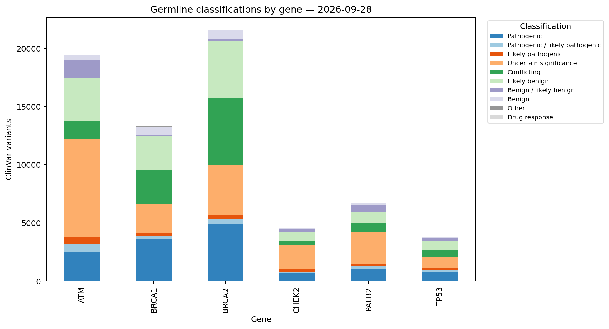

# ClinVar Hereditary-Cancer Reclassification Monitor

A reproducible Python portfolio project that compares two public **ClinVar GRCh38**
releases and identifies changes in aggregate germline variant classifications and
review status for a focused hereditary-cancer gene panel.

**Starter panel:** `ATM`, `BRCA1`, `BRCA2`, `CHEK2`, `PALB2`, and `TP53`

> **Educational use only.** This repository is not a clinical decision-support tool.
> It must not be used for diagnosis, treatment, genetic counseling, patient-specific
> interpretation, or any other clinical purpose.

## About me and this project

I'm Kaan Gurses, and this is my bioinformatics portfolio project. My focus is on
tracking changes in hereditary-cancer variant classifications and understanding how
those changes relate to ClinVar review status.

I use this repository to develop my skills in Python, genomic data analysis, testing,
and reproducible research. My learning and maintenance checklist is in
[`docs/PROJECT_OWNERSHIP.md`](docs/PROJECT_OWNERSHIP.md).

## Why this project

ClinVar is updated continuously as laboratories and expert panels submit or revise
variant classifications. A static analysis answers “what is in ClinVar today?” This
project asks a more useful data-engineering question:

> Which records changed between two releases, and did their evidence-review status
> change at the same time?

The result is an end-to-end workflow rather than a one-off notebook:

- downloads official dated ClinVar releases and verifies their NCBI MD5 checksums;
- streams large gzip-compressed VCF files without loading them entirely into memory;
- filters exact gene symbols from `GENEINFO`;
- compares stable ClinVar Variation IDs;
- separates classification changes from review-status-only changes;
- generates quality-controlled CSV outputs, figures, and a Markdown report;
- provides an interactive Streamlit dashboard;
- includes unit tests and continuous integration.

## My analysis focus

Standard release-diff workflows can report that a classification changed without showing
whether ClinVar's review-evidence level strengthened, weakened, or stayed the same. My
project includes a **classification–evidence context layer** that keeps those two dimensions
separate for every record.

It produces a transparent `change_evidence_matrix.csv`, adds evidence-direction fields to
the variant-level results, and provides a dedicated dashboard filter and chart. This is a
descriptive audit—not a clinical score—but it makes the reason for reviewing a changed
record clearer without overstating what the data prove. My analysis brings together the six-gene panel, the classification–evidence matrix,
automated tests, and a dashboard. I do not claim that ClinVar monitoring itself is new.

The validated findings are documented in
[`docs/KAAN_2026_FINDINGS.md`](docs/KAAN_2026_FINDINGS.md). In the 1,018 classification
changes detected, 327 coincided with a stronger review-star level, 290 with a weaker
level, and 401 with no star-level change.



## Full-scale validation

The workflow was validated against official archived GRCh38 releases dated
**2026-01-04** and **2026-09-28**. For the six-gene panel it processed 66,526 earlier
records and 69,423 later records, detecting:

- 1,018 grouped classification changes;
- 1,314 review-status-only changes;
- 2,937 records added in the later release;
- 40 records absent from the later release;
- 64,154 unchanged records.

These are database comparison results, not clinical conclusions. Some classification
changes reflect aggregation terminology shifts—for example `Pathogenic` to
`Pathogenic / likely pathogenic`—rather than movement from one side of a clinical
decision boundary to another.





The compact validation export in `reports/real_2026/` includes all notable changes and
summaries. Large reproducible intermediate tables are intentionally excluded from Git.

## Demonstration

The repository includes a small **synthetic** VCF pair so the complete pipeline can be
run immediately. The synthetic IDs and results are intentionally not clinical data.

The included dashboard opens with this small demonstration so it remains fast and easy
to inspect.

## Quick start

### 1. Create an environment

```bash
python -m venv .venv
```

Activate it:

```bash
# Windows PowerShell
.venv\Scripts\Activate.ps1

# macOS or Linux
source .venv/bin/activate
```

### 2. Install

```bash
python -m pip install --upgrade pip
python -m pip install -e .
```

### 3. Run the demonstration

```bash
clinvar-monitor demo
```

Results are written to `reports/demo/`.

### 4. Open the dashboard

```bash
streamlit run app.py
```

The dashboard opens with the synthetic demonstration. To explore the packaged official
validation, change **Results directory** in the sidebar to `reports/real_2026`. That
compact view uses the full-run summary for metrics and charts while displaying only
changed, added, and removed records in the variant table.

### 5. Run the tests

```bash
python -m unittest discover -s tests -v
```

## Compare official ClinVar releases

ClinVar VCF releases are large (often more than 150 MB each compressed), so raw files
are deliberately excluded from Git. The two dates below are known archive releases.

```bash
clinvar-monitor download \
  --date 2026-01-04 \
  --output data/raw/clinvar_20260104.vcf.gz

clinvar-monitor download \
  --date 2026-09-28 \
  --output data/raw/clinvar_20260928.vcf.gz
```

Then compare them:

```bash
clinvar-monitor analyze \
  --earlier data/raw/clinvar_20260104.vcf.gz \
  --later data/raw/clinvar_20260928.vcf.gz \
  --earlier-label 2026-01-04 \
  --later-label 2026-09-28 \
  --genes ATM,BRCA1,BRCA2,CHEK2,PALB2,TP53 \
  --output reports/local
```

On Windows PowerShell, place the command on one line or use PowerShell backticks
instead of backslashes.

## Output files

| File | Purpose |
|---|---|
| `variants_earlier.csv` | Gene-filtered records from the earlier release |
| `variants_later.csv` | Gene-filtered records from the later release |
| `variant_comparison.csv` | Complete outer-join comparison by Variation ID |
| `notable_changes.csv` | Added, removed, classification-changed, and review-changed records |
| `classification_counts.csv` | Counts by release, gene, and grouped classification |
| `gene_change_summary.csv` | Comparison outcomes summarized by gene |
| `change_evidence_matrix.csv` | Change types cross-tabulated by review-evidence direction |
| `quality_summary.json` | Machine-readable run counts |
| `REPORT.md` | Human-readable summary and limitations |
| `figures/*.png` | Portfolio-ready visual summaries |

## What counts as a change?

Records are linked by the ClinVar **Variation ID**, the third column in the VCF. The
workflow uses an outer join so that it can detect:

1. records added in the later release;
2. records absent from the later release;
3. changes in grouped aggregate germline classification;
4. changes in aggregate germline review status;
5. records unchanged across both dimensions.

The project does not call a change an “upgrade” or “downgrade.” Clinical significance
is not a simple numeric scale, and conflicting evidence should not be forced into a
linear ranking.

## Review stars

ClinVar review status is mapped to the public star representation:

| Stars | Aggregate germline review status |
|---:|---|
| 4 | Practice guideline |
| 3 | Reviewed by expert panel |
| 2 | Criteria provided, multiple submitters, no conflicts |
| 1 | Criteria provided (single submitter or conflicting classifications) |
| 0 | No assertion criteria, no classification, or another zero-star state |

Stars describe review status and consensus. They are **not** probabilities that a
classification is correct.

## Data provenance

- [ClinVar overview](https://www.ncbi.nlm.nih.gov/clinvar/intro/)
- [Accessing and using ClinVar data](https://www.ncbi.nlm.nih.gov/clinvar/docs/maintenance_use/)
- [ClinVar VCF README](https://ftp.ncbi.nlm.nih.gov/pub/clinvar/README_VCF.txt)
- [Review status in ClinVar](https://www.ncbi.nlm.nih.gov/clinvar/docs/review_status/)
- [Representation of classifications](https://www.ncbi.nlm.nih.gov/clinvar/docs/clinsig/)
- [GRCh38 VCF archive](https://ftp.ncbi.nlm.nih.gov/pub/clinvar/vcf_GRCh38/archive_2.0/)

ClinVar states that its VCF files include simple variants with precise endpoints that
map to GRCh37 and/or GRCh38 and are under 10 kb. Therefore, this project does not cover
every ClinVar record or every type of structural variation.

## Repository structure

```text
.
├── app.py                         # Streamlit dashboard
├── config/genes.json              # Default gene-panel configuration
├── data/demo/                     # Synthetic test VCF files
├── data/raw/                      # Downloaded official releases; ignored by Git
├── docs/                          # Methodology and portfolio walkthrough
├── reports/demo/                  # Reproducible synthetic demonstration
├── src/clinvar_monitor/           # Parsing, comparison, download, and CLI code
└── tests/                         # Unit and end-to-end tests
```

## Scientific and technical limitations

- The VCF is not ClinVar's fully comprehensive product; some large and complex records
  are outside its scope.
- The workflow analyzes aggregate germline classifications, not individual submitter
  assertions.
- A changed aggregate label does not reveal the causal evidence or submission history.
- Gene associations in `GENEINFO` should not be interpreted as proof of disease causality.
- Grouping classifications improves summary readability but necessarily removes detail.
- Release-to-release disappearance can result from representation or mapping changes; it
  should not automatically be treated as a withdrawn scientific conclusion.
- Every important record must be reviewed on the current ClinVar page and against primary
  evidence by qualified professionals.

## Portfolio use

My learning goals are to understand and explain:

- why Variation ID is used as the comparison key;
- how a VCF INFO field is parsed;
- why the parser streams the source file;
- the difference between classification and review status;
- why review stars are not accuracy scores;
- why the tool cannot support patient-level decisions.

See [`docs/PORTFOLIO_GUIDE.md`](docs/PORTFOLIO_GUIDE.md) for interview questions and
a project description.

## License

Code is released under the MIT License. ClinVar data remain subject to NCBI's terms and
policies. Users are responsible for reviewing the applicable data-use guidance.

